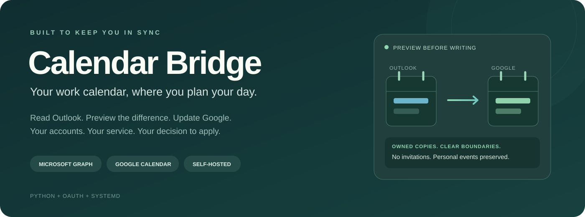
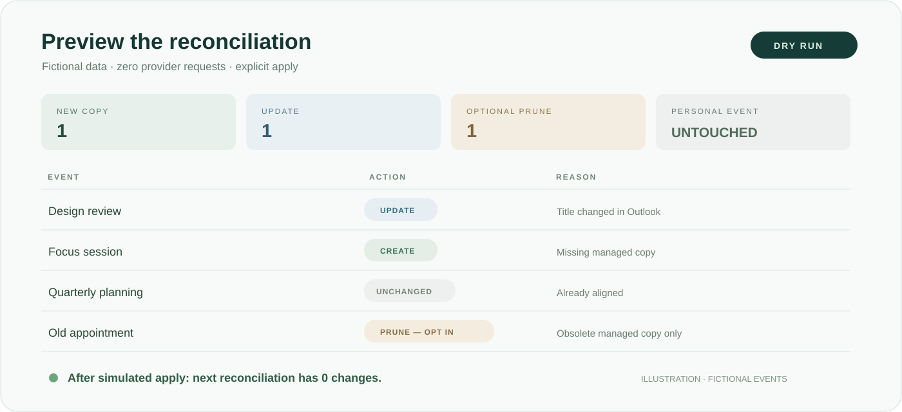
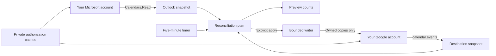

<p align="center">
  
</p>

<p align="center">
  <a href="https://github.com/i-xoxol/outlook-google-calendar-bridge/actions/workflows/tests.yml"></a>
  
  <a href="LICENSE"></a>
  
  
</p>

<p align="center">
  <strong>A small calendar service you can understand, run, and own.</strong><br>
  Read Outlook. Preview the difference. Keep Google Calendar up to date.
</p>

<p align="center">
  <a href="docs/getting-started.md">Set it up</a> ·
  <a href="docs/architecture.md">How it works</a> ·
  <a href="docs/configuration.md">Configure it</a> ·
  <a href="docs/deployment.md">Run it continuously</a> ·
  <a href="docs/troubleshooting.md">Troubleshoot</a>
</p>

## Why I built this

I wanted work commitments to appear in the calendar I use to plan my day. I also
wanted to know what would change, which copies belonged to the bridge, and what
would happen when a sign-in expired.

The project grew from a one-way calendar mirror into a scheduled service with
verified session recovery, bounded writes, and explicit ownership of mirrored
events. Its private predecessor has been used with real calendars. This public
edition adds deployment-neutral configuration, a local Google sign-in flow, and
safer defaults. Examples and visuals are fictional; no account credentials,
personal calendar data, private server configuration, or deployment history are
included. Use your own OAuth applications and accounts.

## What you can do

| Capability | How it works |
|---|---|
| **See the difference first** | Preview is the default. Calendar writes require `--apply`. |
| **Mirror work commitments** | Read your Outlook primary calendar and choose a Google destination. |
| **Keep useful event semantics** | Timed and all-day events, busy/free status, reminders, visibility, suffix, and color are mapped. |
| **Handle changes and cancellations** | Managed copies are updated. Removing obsolete copies requires `--allow-deletes`. |
| **Leave personal events alone** | Only copies carrying this bridge's private ownership marker can be updated or pruned. |
| **Recover an expired session** | An optional private cache can recover Microsoft authorization for the same account, tenant, authority, application, and token family. |
| **Run on a schedule** | A Linux user timer runs every five minutes; no incoming webhook or public server is needed. |
| **Keep logs restrained** | Successful runs report counts by default. Names appear only with `--show-details`. |

> **Privacy defaults:** mirrored events are private; descriptions, meeting links,
> and locations are omitted. Event titles and times still cross into Google.
> Review your organization's policy and destination sharing before enabling writes.

## Try it without any accounts

```bash
git clone https://github.com/i-xoxol/outlook-google-calendar-bridge.git
cd outlook-google-calendar-bridge
python3 -m venv .venv
source .venv/bin/activate
python -m pip install -r requirements-dev.txt
python scripts/demo.py
```

The demo makes zero provider requests. A second reconciliation produces zero
changes, and the personal event remains. The CLI targets **Linux and macOS**;
on Windows use WSL2. Native Windows execution is not supported by this release.

<p align="center">
  
  <br><sub>Illustrative preview with fictional data. Operate the service through the CLI.</sub>
</p>

## Architecture



The reconciler plans from complete snapshots before writing. Private Google
extended properties identify owned copies. OAuth refresh and optional Microsoft
recovery keep credentials local. [Read the walkthrough →](docs/architecture.md)

## Connect your own calendars

1. Register a Microsoft public-client application with delegated **User.Read** and
   **Calendars.Read**, and enable device-code sign-in.
2. Create a Google **Desktop app** OAuth client, enable Calendar API, and configure
   the consent screen for your account.
3. Copy the settings and keep credentials in an ignored private directory:

```bash
cp config.example.toml config.toml
mkdir -m 700 private
# Save your Google Desktop client JSON as private/google-client.json.
chmod 600 private/google-client.json
```

Set `microsoft.client_id` to **your** application ID in `config.toml`. Then:

```bash
python ms_auth.py login --config config.toml
python google_auth.py login --config config.toml
python calendar_bridge.py --config config.toml
```

Microsoft uses device-code sign-in. Google receives the result through a
temporary `127.0.0.1` callback protected by state and PKCE. Run Google sign-in on
the machine with your browser; no authorization code is copied into a shell
command. The final command previews only.

**Follow [the complete setup guide](docs/getting-started.md)** for provider registration,
headless deployment, consent policy, and your first controlled test.

After reviewing the preview:

```bash
python calendar_bridge.py --config config.toml --apply --max-writes 10
# Only if you want obsolete managed copies removed:
python calendar_bridge.py --config config.toml --apply --allow-deletes
```

## Documentation

| Guide | Contents |
|---|---|
| [Getting started](docs/getting-started.md) | Your OAuth apps, browser sign-in, first preview and controlled apply |
| [Configuration](docs/configuration.md) | Every TOML setting, CLI overrides, privacy defaults, state locations |
| [Architecture](docs/architecture.md) | Snapshots, ownership, duplicates, timestamps, authentication recovery |
| [Deployment](docs/deployment.md) | Linux/systemd, headless credential transfer, updates and backups |
| [Security and privacy](docs/security.md) | Permissions, private storage, logging, sharing, threat model |
| [Testing](docs/testing.md) | Offline suite, fictional demo, manual acceptance checklist |
| [Troubleshooting](docs/troubleshooting.md) | Expired sessions, consent, file permissions, time zones, failed runs |
| [Design notes](docs/design-notes.md) | Tradeoffs, limits, and extension points |

## Development

```bash
python -m unittest discover -v
python scripts/demo.py
python scripts/audit_release.py
```

CI runs the offline suite and release audit on Python 3.11–3.14. Tests use mocks
and temporary private files. Release audit checks tracked files for runtime
state, likely secrets, and deployment-specific paths.

```text
calendar_bridge.py      Fetch, normalize, plan, reconcile
ms_auth.py              Microsoft sign-in, refresh, verified recovery
google_auth.py          Google OAuth, state, PKCE, loopback callback
settings.py             Validated TOML configuration
config.example.toml     Blank provider settings and safe defaults
deploy/                 Linux user service and timer examples
docs/                   Replication guides and portfolio visuals
scripts/                Fictional demo and public release audit
test_*.py               Offline regression and security tests
```

## Current limits

- One owner, one Outlook primary calendar, and one Google destination per instance.
- One-way reconciliation; Google edits do not flow back and may be overwritten.
- Recurring occurrences are mirrored within the time window, not as a Google series.
- No attendees, invitations, attachments, webhooks, or multi-tenant control panel.
- Consent, MFA, sign-in-frequency rules, quotas, and token expiry still apply.
- Legacy custom Outlook time zones are rejected rather than silently shifted.
- Changing ownership identifiers or the destination requires a migration plan.

## License and contributions

Created by **Igor Khokhlov**. Released under the [MIT license](LICENSE).
Issues and focused pull requests are welcome; see [CONTRIBUTING.md](CONTRIBUTING.md).
For vulnerabilities, follow [SECURITY.md](SECURITY.md). Never include real events,
tokens, account exports, or unredacted credentials in a public issue.

Another project in this portfolio: [Phone Assistant](https://github.com/i-xoxol/phone-assistant).
