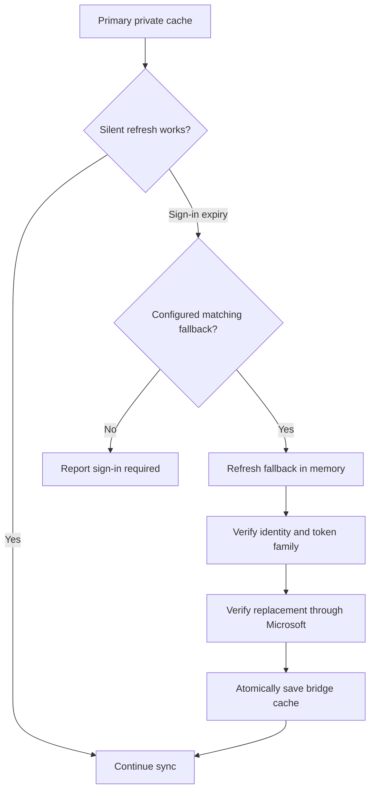

# Architecture

[← Project overview](../README.md) · [Security](security.md) · [Design notes](design-notes.md)

## One reconciliation cycle

1. Validate configuration and obtain an exclusive lock for the state directory.
2. Renew Microsoft and Google authorization.
3. Read the complete Outlook primary-calendar window, including expanded recurring occurrences.
4. Read the complete destination window from Google.
5. Normalize event fields and build a complete create/update/prune plan.
6. Preview counts, or apply a bounded set of changes when explicitly enabled.

Fetching both snapshots must succeed before writes begin. Pagination is followed
for both providers. Microsoft next links are restricted to the expected HTTPS Graph
origin. The source is read-only throughout.

## Ownership and duplicate handling

Every mirror carries private Google extended properties: `bridgeName`,
`outlookEventId`, `outlookICalUID`, and `outlookLastModified`. The source ID links a
Google copy to an Outlook occurrence. Immutable Microsoft IDs reduce churn when
an item moves. This metadata is a convention, not encryption or a cryptographic
proof of ownership; use an owner-controlled destination.

Existing managed copies are compared across normalized fields and updated only
when different. A matching unmanaged title/start/end causes a skip rather than a
duplicate. Such an event is never adopted or modified automatically. That heuristic
is intentionally conservative and can skip two distinct appointments with the
same title and time.

Pruning considers only this namespace's copies whose source IDs are absent from
the complete window. It remains disabled without `--allow-deletes`. A changing
window can affect boundary events, so inspect pruning previews when changing horizons.

## Times and event semantics

Timed values are normalized to UTC instants. All-day dates are reconstructed in
the original Outlook time zone, including Windows-to-IANA aliases, then mapped to
Google's exclusive end-date representation. Unknown legacy custom time zones stop
the run before event writes. Recurring occurrences are separate copies within the
window; the bridge does not author recurrence rules in Google.

Busy/free, private visibility, reminders, color, suffix, and optional details are
mapped. Attendees and attachments are never copied. Editing a Google mirror does
not change Outlook; its next reconciliation may restore the source values.

## Session lifecycle

The fallback file is never saved. Cache writes are atomic, owner-only, and guarded
against competing writers. A recovered session must remain bound to the established
account. Network failures, wrong accounts, changed authorities, or rejected
authorization do not cause blind credential replacement. If all sessions require
interaction, the operator must sign in again.

## Failure and retry

The Linux timer runs the one-shot service repeatedly. A failed write can leave a
partially applied plan; the next complete snapshot normally reconciles the remainder.
There is no cross-provider transaction or exactly-once delivery guarantee. A write
cap limits per-run changes; deferred operations are handled by later runs. The
service timeout bounds stalled executions.
